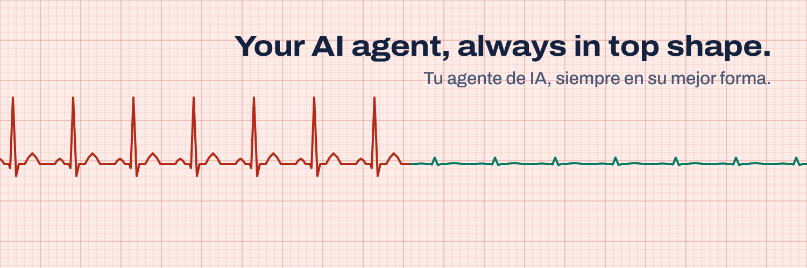

## Psyseal

**Your AI agent, always in top shape.** Psyseal checks, cleans up and seals AI agents: OpenClaw, Hermes Agent, nanobot, PicoClaw, ZeroClaw, NanoClaw and any agent folder.

- **[scanner](https://github.com/psyseal/scanner)**: the free scanner (MIT-0). It shows what your agent's heartbeats and scheduled tasks cost in tokens, which API keys are exposed and which memory is bloated or carries planted instructions. It runs on your computer and sends nothing.
- **Cleanup**: fixes those findings, with a backup first and your OK on each change (paid plan).
- **Seal**: a signed public page and a badge for your agent's README. Anyone can verify the signature. It is not a certification.

**Tu agente de IA, siempre en su mejor forma.** Psyseal revisa, limpia y sella agentes de IA. El escáner es gratis, corre en tu computadora y no envía nada; la limpieza y el sello son de pago.

[psyseal.com](https://psyseal.com) · [After you buy / Después de comprar](https://psyseal.com/guia) · [For AI agents: llms.txt](https://psyseal.com/llms.txt) · [X: @psyseal_ai](https://x.com/psyseal_ai)
